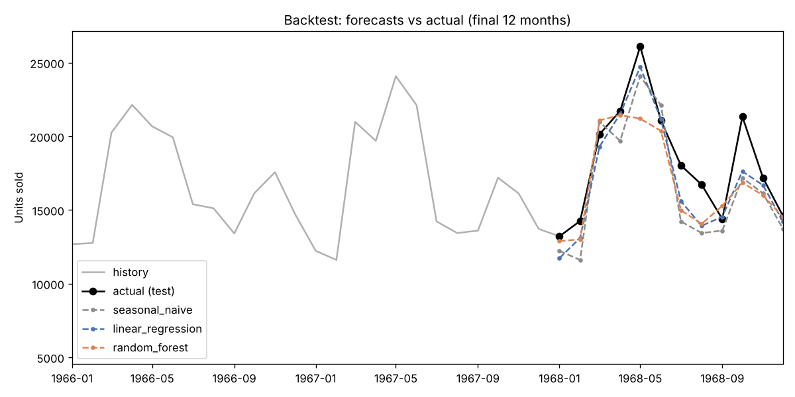
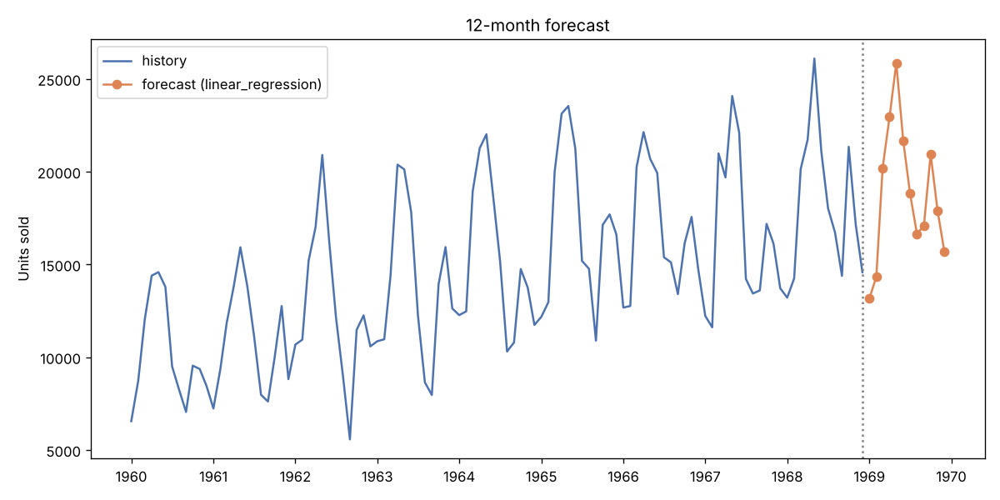

# Monthly Car Sales Forecasting

A time-series project: take about nine years of monthly car sales, work out the
trend and seasonality, then test a few forecasting methods and predict the next
12 months.

Data is the classic monthly car sales series (108 months, Jan 1960 – Dec 1968),
from [jbrownlee/Datasets](https://github.com/jbrownlee/Datasets).

## Approach

I framed forecasting as a supervised problem — use the previous 12 months as
features to predict the next month — and compared three methods, scored on a
held-out final year (the model never sees those 12 months during training):

| Model | MAE | RMSE | MAPE |
|-------|-----|------|------|
| Seasonal naive (baseline) | 1,959 | 2,291 | 10.8% |
| **Linear regression (lag features)** | **1,260** | **1,688** | **7.0%** |
| Random forest (lag features) | 1,730 | 2,342 | 8.9% |

The seasonal-naive baseline (just repeat the value from 12 months ago) is there
as a sanity check — any real model should beat it. Linear regression on the lag
features came out best, cutting the error roughly in half.

Forecasts are made recursively: predict next month, feed that prediction back in
as a lag, predict the month after, and so on across the 12-month horizon.



## What the data shows

- Clear yearly seasonality — sales peak in late spring (around May/June) and dip
  in winter.
- An overall upward trend across the nine years.

Both show up in `outputs/figures/` (seasonality bar chart and yearly-trend line).

## Forecast

Next 12 months (Jan–Dec 1969), from the best model, saved to
`outputs/forecast_next_12_months.csv`:



## Running it

```bash
pip install -r requirements.txt
python src/forecast.py
```

Writes all charts to `outputs/figures/`, the backtest metrics to
`outputs/metrics.json`, and the 12-month forecast to
`outputs/forecast_next_12_months.csv`.

## Layout

```
data/     monthly-car-sales.csv  (108 months)
src/      forecast.py  - EDA, backtest, forecast
outputs/  figures, metrics.json, forecast_next_12_months.csv
```

## Notes

I kept the models simple and transparent on purpose — with only ~100 data points,
a heavy model would just overfit. Linear regression on lag features is quick to
train, hard to overfit here, and easy to explain, which is what you want for a
short series like this. A natural next step would be a proper seasonal model
(SARIMA / Holt-Winters) to compare against.

---

Hitesh Bharambe · [GitHub](https://github.com/HiteshBharambe99) · [LinkedIn](https://linkedin.com/in/hitesh-bharambe)
